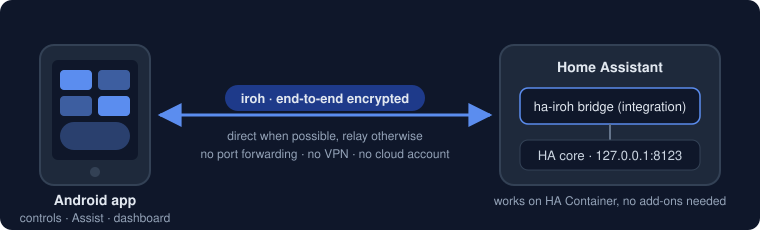

<p align="center"></p>
<h1 align="center">ha-iroh</h1>

**Reach your Home Assistant from anywhere, without port forwarding, VPNs or a cloud subscription.**

ha-iroh is a small Android app plus a Home Assistant integration. They talk to each other over [iroh](https://iroh.computer), a peer-to-peer QUIC transport: the connection is end-to-end encrypted, punches through NAT where it can and falls back to a relay where it can't. Nothing is exposed on your router, and no third party ever sees your traffic in the clear.



## What you get

- **Device Controls** in the Android power menu / quick settings panel: lights, switches, fans, climate, covers, locks, scenes, scripts and buttons, with live state.
- **Assist** from a Quick Settings tile or launcher shortcut, text today, voice planned.
- **Your normal dashboard**: the HA frontend in the app, logged in once, works with any HA auth provider including MFA.
- **Multiple Home Assistant servers**, each behind its own bridge, one app identity for all of them.
- **No always-on connection**: the app connects when you open something and disconnects when you're done.

Not included on purpose: sensors, location, notifications, widgets, wake word, Wear OS, iOS. The official HA app is still the right tool for those.

## Install

You need Home Assistant (any install type, HA Container works) with [HACS](https://hacs.xyz), and an Android 12+ phone.

### 1. Home Assistant integration

1. HACS → ⋮ → **Custom repositories** → add `https://github.com/pzeinlinger/ha-iroh`, category *Integration*.
2. Install **HA iroh** and restart Home Assistant. The release bundles the bridge for x86_64 and aarch64.
3. Settings → Devices & services → **Add integration** → "HA iroh". The bridge starts as a subprocess of HA.

### 2. Android app

Add `https://github.com/pzeinlinger/ha-iroh` as an app in [Obtainium](https://obtainium.imranr.dev/). It installs the latest release APK (arm64) and keeps it updated. You can also grab the APK from [Releases](https://github.com/pzeinlinger/ha-iroh/releases) directly.

On Android 16+ allow the **local network** permission when asked, otherwise direct connections on your LAN won't work.

### 3. Pair

1. In HA: HA iroh → **Configure** → *Add device*. A QR code appears.
2. In the app: *Add server* → scan the QR code → log in with your HA credentials.
3. Pick the entities you want in Device Controls. Done.

Deleting the device in HA revokes the phone. Pairing codes are single use and expire after 10 minutes.

### Optional: a faster path from outside your LAN

Configure → Settings → **Bridge UDP port**: set a fixed port and forward it (UDP) on your router. iroh then dials your HA directly instead of going through a relay. Leave it at `0` if you'd rather not touch the router; the relay path works everywhere, just with a bit more latency.

The relay defaults to the public n0 relays. You can point it at your own via the *relay* setting (comma-separated URLs).

### Please read: two HA settings that bite

- **`ip_ban_enabled`**: the bridge connects to HA from 127.0.0.1, so a phone's failed logins count against localhost. A few bad passwords can lock out *every* paired phone. Keep `login_attempts_threshold` high or leave IP banning off.
- **`trusted_networks`**: never list `127.0.0.1` or `::1` in the trusted networks auth provider. Every paired phone would be able to log in as any user without a password.

HA must listen on 127.0.0.1 (the default). A non-loopback `http.server_host` is not supported.

## How it works

The bridge is a dumb pipe: one iroh QUIC stream maps to one TCP connection to HA on port 8123, raw bytes both ways. It never parses HTTP. The app holds all the HA knowledge (auth, WebSocket API, Assist, the frontend) and reaches HA through a custom socket factory on top of iroh. Only phones whose iroh EndpointId is on the bridge's allowlist get through; the allowlist is filled by scanning the pairing QR code.

Full design: [SPEC.md](SPEC.md).

## Contributing

Bug reports and PRs welcome at [github.com/pzeinlinger/ha-iroh](https://github.com/pzeinlinger/ha-iroh/issues).

- **Report a bug** with HA version, Android version, whether you were on LAN / mobile data, and the bridge log (Settings → System → Logs, filter `ha_iroh`). For the app, `adb logcat -s ha_iroh_core` shows the iroh side.
- **Before a PR**: `cargo test --workspace`, `cd android && ./gradlew testDebugUnitTest`, and the integration tests (see below). Keep PRs small and on-topic; open an issue first for anything that changes the protocol or the pairing flow.
- **Scope**: the non-goals above are deliberate. PRs adding sensors, notifications or widgets will be declined; the official app covers them.
- **Style**: no new dependencies for things a few lines can do. Rust is `cargo fmt` + `cargo clippy` clean, Kotlin follows the Android Studio defaults.

## Local development

Everything below is only needed if you want to build from source.

### Toolchain

1. Install [Nix](https://nixos.org/download), [devenv](https://devenv.sh) and direnv.
2. Install Android Studio. In SDK Manager install: Android SDK Platform 37, Build-Tools, NDK (Side by side), Command-line Tools, Platform-Tools.
3. `direnv allow` (or `devenv shell`). This sets `ANDROID_HOME` (default `~/Library/Android/sdk`) and `ANDROID_NDK_HOME` to the newest `ndk/*`; re-enter the shell after installing the NDK.

Nix supplies Rust stable with the Android targets, cargo-ndk and JDK 17. Docker is needed for the musl bridge build and for a throwaway HA.

### Repo layout

```
proto/                    shared: ALPNs, ticket format, pairing messages
bridge/                   ha-iroh-bridge binary (runs next to HA)
core/                     Rust lib for the app (uniffi); examples/cli.rs = desktop test client
custom_components/ha_iroh HA integration: runs the bridge, config flow, devices
android/                  Gradle project, Compose app, generated uniffi Kotlin
tests/                    integration tests (pytest-homeassistant-custom-component)
scripts/                  release-zip.sh (musl bridge + HACS zip), setup-signing.sh
```

### Build

```sh
cargo build
# Android: native libs -> Kotlin bindings (committed; regenerate when core's API changes) -> APK
# keep `-p ha_iroh_core`: it keeps iroh's portmapper feature off (a workspace-wide build turns it on)
cargo ndk -t arm64-v8a -t x86_64 -o android/app/src/main/jniLibs build -p ha_iroh_core --release
rm android/app/src/main/jniLibs/*/libiroh*.so   # stray iroh cdylibs cargo-ndk copies; not needed
cargo run -p ha_iroh_core --features bindgen --bin uniffi-bindgen -- generate \
  --library target/debug/libha_iroh_core.dylib --language kotlin --out-dir android/app/src/main/java
cd android && ./gradlew assembleDebug
```

Debug screen: paste a pairing URI (or `adb shell am start -n dev.ha_iroh.app/.MainActivity --es ticket '<uri>'`), Pair, then GET /api/.

Installing a release-signed APK over a debug build fails (different signature): uninstall the debug build first and re-pair.

### Tests

```sh
cargo test --workspace
cd android && ./gradlew testDebugUnitTest
python -m venv .venv-ha && .venv-ha/bin/pip install pytest-homeassistant-custom-component && .venv-ha/bin/pytest tests
```

### Standalone bridge

For HA on another host, or without HACS. Config (`ha-iroh-bridge.toml`, every key optional):

```toml
ha_addr = "127.0.0.1:8123"
secret_key_path = "ha-iroh-bridge.key"   # generated 0600 on first run
allowlist_path = "allowlist.toml"
relay = "n0"                             # or ["https://relay.example/"]
name = "Home Assistant"
bind_port = 0                            # fixed UDP port for a router port forward; 0 = random
pair_ttl = 600                           # pairing code lifetime, seconds
```

```sh
cargo run -p ha_iroh_bridge -- run --config ha-iroh-bridge.toml   # prints EndpointId
```

The admin channel is JSON lines on stdin/stdout (logs go to stderr). Stdin EOF shuts the bridge down.

```sh
(echo '{"cmd":"pair"}'; sleep 600) | cargo run -p ha_iroh_bridge -- run
# {"event":"ready","endpoint_id":"..."}
# {"ok":true,"ticket":"ha-iroh://pair?t=...","code":"..."}
# {"event":"paired","endpoint_id":"...","device_name":"..."}   (after a client pairs)
```

Other commands: `{"cmd":"list"}` → `{"ok":true,"devices":[{endpoint_id,device_name,added_at}]}`. `{"cmd":"revoke","endpoint_id":"..."}` → `{"ok":true}` or `{"ok":false,"error":"not_found"}` and closes that device's live connections (`internal` means the allowlist could not be written).

The ticket URI is what the HA integration renders as a QR code. Paired devices are appended to the allowlist and take effect immediately.

Desktop test client (generates `cli.key` on first run; refused until paired):

```sh
cargo run -p ha_iroh_core --example cli -- pair '<ha-iroh://pair?t=...>' --device-name cli
cargo run -p ha_iroh_core --example cli -- curl /api/ --bridge <bridge EndpointId>
```

### HA integration from source

Copy `custom_components/ha_iroh` into `<config>/custom_components/` and run `scripts/release-zip.sh` to build the bundled binaries, or put a `ha-iroh-bridge` on PATH (it wins over the bundled one).

### Releasing

Push a `v*` tag. CI builds the musl bridges, the HACS zip and the signed APK and attaches them to a GitHub Release. Maintainers run `scripts/setup-signing.sh` once to create the signing key and GitHub secrets.

## License

[MIT](LICENSE)
